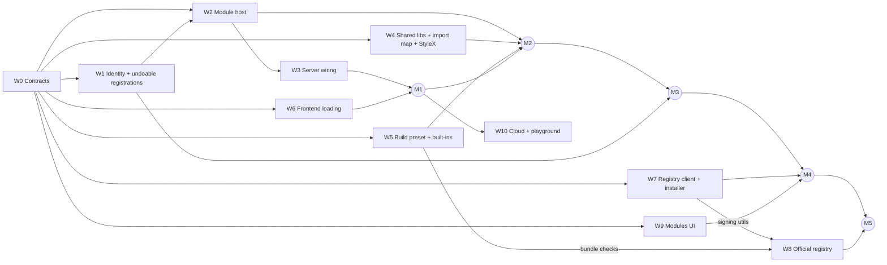

# Dynamic modules

Status: draft spec. No implementation yet.

## Summary

On server builds, every module is a folder on disk, loaded at runtime by one module registry. That includes the built-ins: they are official registry packages that come preinstalled with the server. Each module's RPCs, UI and assets are served under one route, `/module/:namespace/:publisher/:name/*`. Module ids are namespaced by where the module came from (the local folder, the official registry, or another registry), so two modules can never claim the same id. Remote registries are just more namespaces. The official registry only accepts approved publishers and marks each release as trusted or untrusted. Installing an untrusted release requires explicit confirmation, and the server enforces that.

## Goals

- Server builds load modules entirely from the filesystem at runtime, through the same code path for built-in, local and installed modules.
- One module registry. No separate system for "custom" modules.
- One route per module, keyed by module id, serving RPCs, UI and assets. The only module-related endpoints beyond that manage the registry itself (discovery, reload, install).
- Module UI loads at runtime from URLs on server builds. Hosts that can't load from disk can still bundle it.
- Manual reload, with a file watcher that marks modules whose files changed on disk ("stale").
- Unloading or reloading a module doesn't leak its old server code.
- Install from remote registries, with trust levels and confirmation for untrusted releases.
- An official registry where only approved publishers can publish.

## Non-goals

- Sandboxing. Modules are trusted code that runs inside the server process and on the editor's origin.
- Loading modules at runtime in the cloud (Cloudflare) or the playground. They use a static module list (see [Cloud and playground](#15-cloud-and-playground)).
- Backwards compatibility with current module ids, saved projects or module APIs.
- Migrating engine storage between module versions.

## Decisions

| Topic                                                     | Decision                                                                                                              |
| --------------------------------------------------------- | --------------------------------------------------------------------------------------------------------------------- |
| Built-ins on server builds                                | Loaded from the filesystem like any other module. They are official registry packages preinstalled in `dist/modules`. |
| Module RPC transport                                      | HTTP only, one RPC server per module                                                                                  |
| Sharing libraries between host and modules in the browser | An import map                                                                                                         |
| Id collisions                                             | Ruled out by namespacing ids by source                                                                                |
| Reload                                                    | Manual. A file watcher only marks modules as stale.                                                                   |
| Memory on reload                                          | Server code is loaded so it can be garbage-collected; the browser keeps old UI code until the page reloads            |
| Distribution                                              | A local folder plus remote registries                                                                                 |
| Moving a module from local to a registry                  | A dev link. A tool that rewrites ids in projects is deferred.                                                         |
| Trust granularity                                         | Per release, defaulting to the publisher's trust level                                                                |
| Revoked releases                                          | Flagged, not disabled automatically                                                                                   |
| Who can publish to the official registry                  | Approved publishers only. Initially just the maintainer; packages need no separate approval.                          |

## Current state

These are the parts of today's code that the design replaces:

- **Build-time module lists.** `virtual:macrograph-module-deployments` and `virtual:macrograph-module-settings` come from `packages/module/src/vite.ts`. The server keeps two hand-written lists: `serverModules` in `apps/server/client/vite.config.ts` and `serverDeployments` in `apps/server/rolldown.config.ts`.
- **Module RPCs merged into the main editor RPC group.** `WorkspaceRpcs` in `apps/server/src/Server.ts` is built once at startup, and every module's RPC names share one namespace. That's why some modules have to call `RpcGroup.prefix`.
- **A per-module HTTP RPC route already exists but the UI doesn't use it.** `apps/server/src/ModuleHost.ts` serves `/module/:moduleId/rpc`.
- **Module settings UIs are bundled into the host.** They are statically imported, and each `Settings.tsx` imports `Module.ts` just to read the module id.
- **Registrations can't be undone.** `Packages.loadPackage`, `Editor.module`, `Executor.module` and the `editor.engine.host*` calls have no removal path.
- **Engine and resource service keys come from global counters.** `packages/module/src/Engine.ts` and `Resource.ts` number them in load order, and `Registration.ts` relies on `instanceof`. Both assume one shared copy of `@macrograph/module`.
- **The production server is one Rolldown file** with Effect bundled in and no `node_modules`.
- **The browser fetches the module catalog once per connection** (`GetPackages`), and nothing tells it when the catalog changes.

## Design

### 1. Module identity

A module id has three parts: `namespace/publisher/name`.

| Namespace         | Example                          | Where it comes from                                         |
| ----------------- | -------------------------------- | ----------------------------------------------------------- |
| Official registry | `<official>/macrograph/twitch`   | Built-ins, and modules installed from the official registry |
| Another registry  | `modules.example.com/bob/lights` | Modules installed from a registry the admin added           |
| `local`           | `local/alice/my-thing`           | The local modules folder                                    |

`<official>` is the official registry's namespace domain, still to be decided (see [Open items](#open-items)).

Rules:

- **The manifest only declares `publisher` and `name`.** The namespace comes from where the module was loaded. The same build is `local/alice/foo` when it's in the local folder and `<official>/alice/foo` once installed from the registry.
- **A registry's namespace is a domain it declares in its own metadata, not its URL.** The registry can change URLs without changing ids. A host refuses to add two registries that declare the same namespace.
- **Allowed characters.** Publisher and name are lowercase letters, digits and hyphens.
- **Reserved names.** The publisher `macrograph` is reserved on the official registry, and `local` is reserved as a namespace.
- **Module code never hard-codes its id.** The host passes the full id in when it loads the module. That replaces `Module.make({ id })` and `HttpIngress.make({ moduleId })`.
- **Everything persisted uses the full id**: `SchemaRef.package`, the keys of `project.engines`, resource refs (`ResourceRef.package`) and ingress manifest entries.
- **Types a module defines are scoped to that module's id.** Today `"github/User"` is only a naming convention. References to another module's types use the full module id.
- **Engine and resource service keys are derived from the module id**, not the global counters. Port refs are recognized by a brand instead of `instanceof`.
- **Short display form.** The UI may show official-registry ids without the namespace, e.g. `macrograph/twitch`.

**Dev links.** A local folder can be linked so that it loads under a registry id (for example `<official>/alice/foo`) instead of `local/...`. That lets an author test changes against real projects that already use the published module. A linked module overrides every other copy of that id, and the UI marks it as linked.

### 2. Module package format

A module package is a folder:

```text
<module>/
  macrograph.json        manifest
  server.cjs             server entry, a single self-contained file
  ui/
    index.js             UI entry (optional)
    *.js                 UI chunks
    styles.css           extracted CSS
  assets/                icon and other static files
  native/<name>/         prebuilt native addons (optional)
    <target>.node        one per target, e.g. darwin-arm64, linux-x64, linux-x64-musl, win32-x64
```

Manifest fields (`macrograph.json`):

| Field                        | Required | Meaning                                                                             |
| ---------------------------- | -------- | ----------------------------------------------------------------------------------- |
| `manifest`                   | yes      | Version of the manifest format                                                      |
| `publisher`, `name`          | yes      | Identity within a namespace                                                         |
| `version`                    | yes      | Semver                                                                              |
| `api`                        | yes      | The host interface version the module was built against (major version, an integer) |
| `displayName`, `description` | yes / no | Shown in the UI                                                                     |
| `server`                     | yes      | Path to the server entry                                                            |
| `ui`                         | no       | Paths to the UI entry and its stylesheets                                           |
| `icon`                       | no       | Path to the icon                                                                    |
| `requires`                   | no       | Host services the module needs (see [Host services](#10-host-services))             |
| `node`                       | no       | Node built-in modules (`node:*`) the server entry may import                        |
| `native`                     | no       | Native addons the package ships under `native/<name>/`                              |

**What the server entry exports.** Its default export is the module's deployment, or the bare module if it has no engine. That replaces today's `macrograph.standaloneDeployment` field in `package.json`.

**What the UI entry exports.** Its default export is a UI descriptor. For now that is just `settings`, today's `ClientSettings` descriptor without the `module` and `id` fields. The host already knows the id, and dropping `module` stops `Module.ts` from leaking into browser bundles. Other UI surfaces can be added later, such as custom property editors or node views.

**No dependencies between modules at runtime.** If one module reuses another's code (GoXLR, SpeakerBot and Stream Deck reuse the websocket modules), that code is bundled into it. Modules can still use each other's types by full id.

**Native addons.** A module that needs a Node-API addon ships its prebuilt binaries as `native/<name>/<target>.node`, where the target is `<platform>-<arch>` plus `-musl` on musl Linux (`ModulePackage.NativeTargets`), declares `<name>` in `native`, and loads it with `require("macrograph:native/<name>")`. In `package.json`, `macrograph.build.native` maps each name to a template such as `"@julusian/midi/prebuilds/midi-{target}/node-napi-v7.node"`, and `macrograph.build.alias` swaps a dependency's own loader for a module-local file that makes that `require` call (MIDI replaces `@julusian/midi/load-native.js`). Publish checks accept only declared names, known targets and real Mach-O, ELF or PE binaries, within size limits.

**Host interface version (`api`).** This number goes up whenever a library shared with the host changes version, or the module-facing API in `@macrograph/module` changes incompatibly. A host supports a set of `api` versions and refuses to load anything else. Until we commit to semver compatibility for shared libraries, every Effect or Solid upgrade raises it.

### 3. Sources and version selection

Folder layout under `<dataDir>/modules/`:

```text
local/<publisher>/<name>/                              loaded as local/<publisher>/<name>
installed/<namespace>/<publisher>/<name>/<version>/    from registries
state.json                                             installs, enabled/disabled state, registries, links, acknowledgements
```

Built-ins ship in `dist/modules/<namespace>/<publisher>/<name>/<version>/`, with the same layout as `installed/`, and count as preinstalled. `state.json` is written with `AtomicFileStore`.

When several copies exist for one id, the host picks one:

1. A dev link always wins.
2. Otherwise, the highest version among the shipped and installed copies whose `api` this host supports.
3. If the installed version isn't compatible, the shipped copy is used and the module is marked `incompatible-installed`.
4. Built-ins can't be uninstalled, only disabled. Downgrading a built-in below the version shipped with the server isn't supported.

The host remembers a content hash for each loaded copy.

### 4. Module registry (host)

`ModuleRegistry` is a server-wide service. It holds one entry per module id, in a `SubscriptionRef`.

| Entry field                | Meaning                                                                                                                      |
| -------------------------- | ---------------------------------------------------------------------------------------------------------------------------- |
| `id`, `manifest`, `source` | Identity, and where the files are (`shipped`, `installed`, `local` or `linked`)                                              |
| `status`                   | `discovered`, `loading`, `loaded`, `failed`, `disabled`                                                                      |
| `flags`                    | `stale`, `revoked`, `updateAvailable`, `incompatibleInstalled`                                                               |
| `error`                    | Why loading failed, readable by a person                                                                                     |
| `trust`                    | Trust status recorded at install, plus the registry's current trust status                                                   |
| `contentHash`              | Hash of the loaded files                                                                                                     |
| `loaded`                   | Only when loaded: the module's scope, its deployment, its RPC HTTP handler, and the folder its UI and assets are served from |

What the registry does:

- **`load(id)`**: picks a copy (section 3), evaluates it (section 6), checks its required host services (section 10), and mounts it in a new scope. Mounting means: `editor.module`, `executor.module`, the engine host layer, the RPC server and the asset roots.
- **`unload(id)`**: closes the module's scope. Every registration made under that scope must undo itself.
- **`reload(id)`**: unload, then load. If loading fails, the entry ends up `failed` with the error; there is no automatic rollback. The old and new engines never run at the same time, so they can't fight over ports or sockets.
- **`rescan()`**: rereads the sources, loads new modules, unloads removed ones, and marks changed ones as stale. It doesn't reload anything by itself.
- **Change events**: every change is published so the server can broadcast `ModulesChanged`.

**On startup**, the registry scans all sources and loads every enabled module. One module failing to load never stops the server.

### 5. Lifecycle and staleness

- **Staleness.** A file watcher covers `local/`, linked folders and, in dev, built-in source folders. It debounces changes and recomputes content hashes. If a hash differs from what's loaded, the entry is flagged `stale` and `ModulesChanged` fires. Nothing reloads automatically.
- **Update available.** This flag comes from checking registries (section 14), not from the watcher.
- **When a module unloads:**
  - Its routes answer with a typed `ModuleNotLoaded` error.
  - Its package is removed from the catalog.
  - Nodes that use it become missing-module placeholders (section 11).
  - Running executions that depend on it are interrupted.
- **When a module loads:**
  - Inputs and outputs are recomputed for every node that uses the module.
  - The new values are broadcast to connected editors.

### 6. Loading server code

The server entry is built as one self-contained file wrapped in a function, CommonJS-style. The host:

1. Reads `server.cjs`.
2. Compiles it with `vm.compileFunction(code, ["require", "module", "exports"], { filename })` in the main context, so stack traces show the real file path.
3. Calls it with a `require` that only resolves:
   - **shared libraries**, returned from a table of the host's own instances. On the server these are `effect`, `effect/*`, `@macrograph/module` and `@macrograph/module/*`.
   - **Node built-ins**, if `node:*` modules are listed in the manifest's `node` field.
   - **Native addons**, `macrograph:native/<name>` for names in the manifest's `native` field. The host picks `native/<name>/<target>.node` for its own platform, checks that it resolves inside the package folder, and opens it with `process.dlopen`. A missing binary fails with "MIDI has no native build for linux-riscv64".
   - Anything else throws.
4. Reads the default export.

Why load it this way:

- **There is only one copy of each shared library.** Effect service keys, fibers and `@macrograph/module` all have to be the host's instances.
- **Unloaded code can be garbage-collected.** The code never enters Node's ES module cache, so once the module's scope is closed and nothing else references it, it can be freed.
- **The production server stays a single file.** The shared-library table is generated and bundled into it.

What this requires:

- **No top-level await** in module server code. The build preset rejects it.
- **All resources must belong to the module's scope.** A timer or listener created outside the scope keeps the old code alive.
- **A test proves the code gets freed**: load and unload a fixture module many times, then check through a `WeakRef` that its exports get collected.
- **The `node` allowlist is not a security boundary.** It keeps declarations honest, nothing more.
- **Native addons can't be unloaded.** The host opens each addon file once per process and hands the same exports to every later load, so a reload reuses it. Native code is the one part of a module that unloading never frees.
- **Dev mode is the one difference.** Built-ins are imported from source through Vite's server runner, so server hot reload keeps working. Everything after evaluation is the same code path.

### 7. HTTP surface

One route family per module:

| Path                                           | Serves                                                                                           | Access                         |
| ---------------------------------------------- | ------------------------------------------------------------------------------------------------ | ------------------------------ |
| `/module/:namespace/:publisher/:name/rpc`      | The module's RPCs                                                                                | Edit access (`canEditRequest`) |
| `/module/:namespace/:publisher/:name/ui/*`     | UI entry, chunks and CSS                                                                         | Same as other static assets    |
| `/module/:namespace/:publisher/:name/assets/*` | Icon and assets                                                                                  | Same as other static assets    |
| `/module/:namespace/:publisher/:name/http/*`   | Reserved for HTTP handlers defined by modules (OAuth callbacks, webhooks on self-hosted servers) | Defined later                  |

How the outer handler works:

1. Parse the module id from the path.
2. Look the module up in the registry. If it isn't found, return 404. If it isn't loaded, return the typed `ModuleNotLoaded` error.
3. Strip the prefix from the request URL and forward the request to the module's handler. This has to be done properly: old MacroGraph's `allAsMounted` helper never actually applied its changes.
4. Serve static files only from inside the module's `ui/` or `assets/` folder. Paths that escape it are rejected.
5. Version every UI and asset URL with the module's content hash, so the files can be cached as immutable.

`/module` is already reserved in `apps/server/src/StaticRoutes.ts`, and the dev proxy already forwards it.

**Admin RPCs.** A separate `ModuleAdminRpcs` group is added to `WorkspaceRpcs`. It manages the registry and isn't specific to any module. Admin access is required for everything except reading the catalog.

| RPC                                                                     | Purpose                                                                                   |
| ----------------------------------------------------------------------- | ----------------------------------------------------------------------------------------- |
| `GetModules`                                                            | The module catalog for the editor (see [UI loading](#9-ui-loading)). Readable by viewers. |
| `ListModules`                                                           | Admin details: source, path, versions available, errors, flags                            |
| `ReloadModule`, `RescanModules`, `SetModuleEnabled`                     | Lifecycle                                                                                 |
| `ListRegistries`, `AddRegistry`, `RemoveRegistry`, `SetRegistryTrusted` | Managing registries                                                                       |
| `SearchRegistry`, `GetRegistryPackage`                                  | Browsing registries, fetched by the server                                                |
| `InstallModule`, `UpdateModule`, `UninstallModule`                      | Installing (section 14)                                                                   |
| `CheckForUpdates`                                                       | Check registries now                                                                      |
| `LinkModule`, `UnlinkModule`                                            | Dev links                                                                                 |

A new event on the editor WebSocket, `ModulesChanged`, tells clients to fetch the catalog again.

### 8. Module RPCs over HTTP

**Server**

- Each loaded module gets its own `RpcServer.toHttpEffect(ClientRpcs)`, built inside the module's scope and served at `.../rpc`. This replaces merging module RPCs into `WorkspaceRpcs`, and with it the need for `RpcGroup.prefix`.
- Access is checked at the route with `canEditRequest`. A module can mark individual RPCs as read-only with an annotation; those only need view access.
- Responses use a framed serialization (NDJSON), so streaming RPCs work over HTTP.

**Browser**

- Each module gets its own HTTP RPC client.
- The client reads the session token on every request and sends it as a bearer token. Old MacroGraph read the token once, which broke after reconnects.
- Each host app provides the protocol for each module through `moduleRpcProtocol(moduleId)`:
  - server: HTTP
  - cloud: HTTP, forwarded into the project's Durable Object
  - playground: in-process, as today

**Pushing from the server.** Module RPCs don't push anything. When the server needs to tell the UI something, it uses events on the editor WebSocket: `ModuleClientStateDirty` and `ModulesChanged`.

### 9. UI loading

**Catalog.** `GetModules` returns, for each module:

- id, version, display name, description
- source, status, flags, trust
- the icon URL
- if the module has UI: the content-hashed URLs of its UI entry and stylesheets

The client fetches it on connect and again on every `ModulesChanged`.

**Loader.** `editor-ui` keeps a map from module id to a lazy loader:

- On server builds the loader is `import(url)`. Cloud and playground pass static loaders that use bundler `import()`.
- A module's UI is loaded only when something needs it, such as opening its settings.
- Its stylesheets are injected when it loads and removed when it unloads.
- When the version changes, the loader imports from the new URL.
- The old UI code stays in memory until the page reloads.
- `createModuleData` and `ModuleSettingsView` become catalog-driven, instead of pre-creating state from a fixed list of descriptors.

**Sharing libraries.** Module UI and the host must use the same instance of each shared library. The browser shared set:

- `solid-js` and its subpaths, `@solidjs/web`
- `effect` and its subpaths
- `@macrograph/module` (browser-safe subpaths)
- `@macrograph/editor-ui` and its subpaths
- `@tanstack/solid-query`
- `@stylexjs/stylex`

Everything else is bundled into each module.

How the import map works:

- The host build emits every shared module as its own ES module under `/_shared/<hash>/...`, with all exports kept. The list is generated from each package's `exports` field.
- The host app itself imports those modules as externals. This gives up tree-shaking for shared libraries.
- `index.html` gets an inline `<script type="importmap">`. The current CSP (`script-src 'self'`) blocks inline scripts, so `StaticRoutes` adds the map's hash to `script-src`, reading it from a build manifest.

**Dev mode.**

- A built-in's UI entry URL is its Vite-transformed source URL. Host and module then share one dependency graph, so they use one instance of each library without an import map, and UI hot reload works.
- A prebuilt module in dev needs an import map that points at Vite's pre-bundled dependencies. That's a stretch goal.

**StyleX.**

- **Token names must not depend on where the file is.** The name of each token variable from `defineVars` is hashed from the file's path relative to the repo root (`unstable_moduleResolution: { type: "commonJS", rootDir }`). A module built outside the monorepo resolves `@macrograph/editor-ui/tokens.stylex` from `node_modules`, gets different names, and its token styles silently break. A spike picks the fix. One option is StyleX's filename-based ("haste") resolution for token files, in both host and module builds.
- **Each module's CSS goes into its own stylesheet.** The host already uses CSS layers (`useCSSLayers`). It declares the layer order before any module CSS loads, so priorities hold across stylesheets. This needs to be verified.

### 10. Host services

Today the compiler checks that the host provides everything an engine layer needs. With runtime loading, the host checks it instead. The host offers a fixed set of named services:

| Id            | Effect services               |
| ------------- | ----------------------------- |
| `http-client` | `HttpClient`                  |
| `file-system` | `FileSystem`, `Path`          |
| `socket`      | `Socket.WebSocketConstructor` |
| `crypto`      | Web Crypto                    |
| `credentials` | `Engine.Credentials`          |

- **Checking.** Before mounting, the registry compares the manifest's `requires` with this set. If something is missing, the module fails with a clear error instead of dying when the layer is built.
- **Services specific to one module go away.** Today the host provides `UrlPolicy` (http-client), `ListenerAdapter` (websocket-server), and Twitch and GitHub `AppCredentials`. Each becomes module configuration or a default inside the module's own deployment.
- **Each built-in's standalone deployment** may only depend on services in the table above.

### 11. Missing modules in projects

Opening a project that uses a module that isn't loaded is now an ordinary case, not an error:

- Nodes that use the missing module load as placeholders. Their saved properties, connections and engine storage are kept unchanged.
- Running a placeholder node fails with `ModuleUnavailable`.
- The editor shows which module is missing and why: not installed, disabled, failed or incompatible.
- When the module loads, the placeholders turn back into real nodes and their inputs and outputs are recomputed.

### 12. Registry protocol

The protocol can be served from plain static files, so a registry can run on GitHub Pages or an R2 bucket. Search and publishing are optional extras.

| Path                                    | Contents                                                                                                                                                                                         |
| --------------------------------------- | ------------------------------------------------------------------------------------------------------------------------------------------------------------------------------------------------ |
| `/.well-known/macrograph-registry.json` | Protocol version, namespace, display name, signing keys (Ed25519)                                                                                                                                |
| `/v1/index.json`                        | Every package: publisher, name, display name, description, latest version                                                                                                                        |
| `/v1/packages/<publisher>/<name>.json`  | Every release of a package. For each release: version, `api`, publish date, manifest, tarball URL, integrity hash (`sha256-…`), trust, status (`active`, `yanked`, `revoked`), reason, signature |
| tarball URL                             | `.tgz` of the package folder. Never changes once published.                                                                                                                                      |
| `/v1/search?q=`                         | Optional. Hosts fall back to filtering `index.json`.                                                                                                                                             |

**Integrity and signatures**

- The host checks every downloaded tarball against its integrity hash.
- Each release record is signed: the canonical JSON of namespace, publisher, name, version, `api`, integrity, trust and status. Changing trust or status means re-signing the record.
- The official registry's public key is built into the server.
- A third-party registry's key is pinned when the admin adds that registry. Key rotation is deferred.

**Trust from third-party registries.** Their trust flags are ignored by default, and every release from them counts as untrusted. An admin can mark a whole registry as trusted.

### 13. Official registry service

The official registry runs on MacroGraph's cloud infrastructure, with MacroGraph accounts as publishers. Tarballs are stored in R2 and metadata in the cloud database.

|                    | Controls                                          | At first                                                                                     | Later                                                                           |
| ------------------ | ------------------------------------------------- | -------------------------------------------------------------------------------------------- | ------------------------------------------------------------------------------- |
| Publisher approval | Who can publish at all                            | An allowlist with only the maintainer (`macrograph` and the maintainer's personal publisher) | People apply and an admin approves                                              |
| Release trust      | Whether a version installs without a confirmation | The maintainer's releases are trusted                                                        | Taken from the publisher's trust level, which an admin can override per release |

- **Approved publishers' packages are listed immediately.** There is no separate package approval.
- **New publishers start untrusted.** An admin can mark a publisher trusted, or trust individual releases.
- **Publish-time checks:**
  - the manifest format is valid and the `api` version is supported
  - the folder layout is correct and size limits are respected
  - the server bundle has no top-level await
  - the bundles don't include their own copy of any shared library
- **Versions can't be changed** once published.
- **Admin actions:** approve, suspend or trust publishers; override trust per release; yank or revoke releases with a reason.
- **Publishing tool:** a CLI command, `macrograph-module publish`, using a MacroGraph account token.
- **Release CI** publishes the built-ins under `macrograph`, using the same tarballs that ship in `dist/modules`.

### 14. Installing modules and trust

The server fetches from registries itself, which fits the current CSP. Only admins can install.

`InstallModule({ id, version?, acknowledgeUntrusted })`:

1. Look up the release and check that its `api` version is supported.
2. If the release is untrusted (after applying the registry's trust level) and `acknowledgeUntrusted` isn't `true`, fail with `UntrustedConfirmationRequired`. **The server enforces this, not just the UI.**
3. If the release is revoked or yanked, refuse.
4. Download the tarball and verify its integrity hash and signature.
5. Unpack it into `installed/...`.
6. Record the install in `state.json`: version, integrity hash, trust at install time, and who confirmed it and when.
7. Load it through the registry.

Rules:

- **Updates** follow the same flow. Updating to an untrusted release asks for confirmation again.
- **Uninstalling** removes the files and the record, and unloads the module. A shipped built-in reverts to its shipped copy.
- **Local modules** never ask for confirmation, because putting files in the folder is the consent. They show a "Local" badge.
- **Checking registries** happens on startup, then daily, plus `CheckForUpdates`. It updates `updateAvailable`, the registry's current trust status, and `revoked`.
- **Revoked modules keep running.** They show a prominent warning with the reason, and installing or updating to a revoked version is refused.

**The confirmation dialog** shows:

- the publisher, the registry, and whether the release is trusted
- the declared `requires`, `node` and `native` lists, with a note that native code runs as part of the server
- a warning that the author isn't verified
- a plain statement that these declarations are not a sandbox

Confirming requires ticking a checkbox.

### 15. Cloud and playground

- **Same registry interface, static list.** They use the same `ModuleRegistry` with a static source built from bundled imports, plus static UI loaders. This replaces the hand-written module lists in `apps/cloud` (`CloudModules.ts`, `ProjectEditorDO.ts`, `ExecutorModules.ts`) and `apps/playground` (`LocalRuntime.ts`).
- **Module RPCs.** In the cloud they use the same per-module HTTP path, scoped to the project and forwarded into the project's Durable Object. The playground keeps calling module RPCs in-process.
- **No runtime installs.** Neither host loads modules from disk or installs from registries.
- **How it's built.** `@macrograph/module-host/core` is the platform-neutral part of the host (registry core, `StaticRegistry`, version selection, catalog projection, `Mounter`, `ModuleTrust`); folder sources, the `vm` loader, the watcher and `state.json` stay in the Node entries. Each host has one list (`apps/playground/src/local/PlaygroundModules.ts`, `apps/cloud/src/modules/CloudModules.ts`) whose entries carry the package metadata and every facet the host needs. The cloud's per-module route is `/rpc/projects/:projectId/module/:namespace/:publisher/:name/rpc`; the worker checks project access and forwards it to `ProjectEditorDO` as `/module/:namespace/:publisher/:name/rpc`, which requires edit access. The editor DO serves `GetModules` on its WebSocket.

### 16. Security model

- **Modules are fully trusted code.** A module's server code, including any native addons it ships, runs inside the server process. Its UI runs on the editor's origin and can call any editor RPC as the signed-in user.
- **Admins control what runs.** The modules folder and installs are admin-only, and there is no upload endpoint.
- **Trust flags and signatures say who vouches for a release.** They don't isolate anything. The UI must say so plainly.

## Implementation plan

### Packages

| Package                                                   | New or changed | Contents                                                                                                                                                                                           |
| --------------------------------------------------------- | -------------- | -------------------------------------------------------------------------------------------------------------------------------------------------------------------------------------------------- |
| `@macrograph/module`                                      | Changed        | `ModuleId`, the `Manifest` schema, the UI entry descriptor, the `ModuleAdminRpcs` definitions, keys derived from the module id, port refs recognized by brand, the module id passed in by the host |
| `@macrograph/module-build`                                | New            | The build preset and the `macrograph-module` CLI (`build`, `dev`, `publish`), plus bundle checks                                                                                                   |
| `@macrograph/module-registry`                             | New            | Protocol schemas, canonical JSON, signing and verification, the registry client                                                                                                                    |
| `@macrograph/module-host`                                 | New (Node)     | `ModuleRegistry`, the sources, the `vm` loader, the server shared-library table, the watcher, the installer, `state.json`                                                                          |
| `@macrograph/core`, `editor`, `execution`, `project-host` | Changed        | Full ids everywhere, registrations that can be undone, missing-module placeholders                                                                                                                 |
| `@macrograph/editor-ui`                                   | Changed        | Catalog-driven module UI, the lazy loader, the per-module protocol factory, the modules management screens                                                                                         |
| `apps/server`                                             | Changed        | Wiring, the `/module/...` routes, the admin RPCs, the import map and CSP                                                                                                                           |
| `apps/cloud` (or a new `apps/registry`)                   | Changed / new  | The official registry service                                                                                                                                                                      |

### Workstreams

**W0 — Contracts (blocks everything else; one person or agent)**

- Scope:
  - `ModuleId` (parsing, formatting, reserved names) and the `Manifest` schema
  - the package folder layout and the server entry convention (function wrapper, injected `require`)
  - the shared-library lists for server and browser
  - the UI entry descriptor (`ClientSettings` without `module` and `id`)
  - catalog entries
  - `ModuleAdminRpcs` and the `ModulesChanged` event
  - the registry protocol schemas
  - the host service ids
- Includes the mechanical change that drops `module` from every `Settings.tsx`.
- Done when: the schemas and RPC definitions compile, and every other workstream can build against them with stubs.

**W1 — Identity and registrations that can be undone** (`core`, `editor`, `execution`, `project-host`, `module`)

- Full ids in `SchemaRef`, `project.engines`, `ResourceRef` and ingress entries.
- The host passes the module id in, replacing `Module.make({ id })` and `HttpIngress.make({ moduleId })`, across all modules.
- Module types scoped to the module id.
- Engine and resource keys derived from the id; port refs recognized by brand.
- Scope-bound registration: `Packages.loadPackage`, `Editor.module`, `Executor.module`, `editor.engine.host*`, `EngineHost` and `ModuleMount` all take a scope and undo themselves when it closes.
- Missing-module placeholders, and recomputing and broadcasting node inputs and outputs when a module loads.
- Done when: tests show that registering then unregistering restores the previous state, and that a project with a missing module opens and keeps its data.

**W2 — Module host** (`module-host`)

- `ModuleRegistry` with its states and change stream.
- Sources: shipped, installed, local and linked, plus a static source for tests and for cloud and playground.
- Version selection and the shipped-copy fallback.
- The `vm` loader with the injected `require`, and the generated server shared-library table.
- Checking required host services.
- Content hashing and the watcher (stale flag).
- `state.json`.
- Mounting goes through W1's scoped registrations. Until W1 lands, use the existing mount functions with unload stubbed out.
- Done when: fixture packages load, unload and reload; the `WeakRef` test shows old code is freed; version selection is covered by tests.

**W3 — Server wiring and HTTP surface** (`apps/server`)

- The `/module/:namespace/:publisher/:name/*` route: prefix stripping, `rpc` handler, `ui/*`, `assets/*`, path safety, immutable caching.
- Remove module RPCs from `WorkspaceRpcs`.
- Admin RPC handlers backed by W2 (and later W7).
- Broadcast `ModulesChanged`.
- Drop `virtual:macrograph-module-deployments`, `serverDeployments` and `serverModules` from the server.
- Done when: `apps/server/test/production.test.ts` covers module RPCs (allowed, 403 for non-editors, 404 for unknown modules, `ModuleNotLoaded`), UI and asset serving, and the admin RPCs.

**W4 — Browser shared libraries, import map, StyleX** (build tooling, `apps/server/client`)

- A generated build of the shared libraries: one ES module per shared specifier, all exports kept.
- The host app imports them as externals.
- Inject the import map, and add its hash to the CSP through a build manifest that `StaticRoutes` reads.
- An import map for dev mode pointing at Vite's pre-bundled dependencies (stretch).
- The StyleX spike: token names that don't depend on file location, and checking layer order across stylesheets.
- Done when: a module UI built outside the host build renders with the right styles, and shares one instance of Solid and Effect with the host. Check this by asserting that the module's imports are identical to the host's.

**W5 — Build preset and packaging the built-ins** (`module-build`, `packages/modules/*`)

- The preset outputs:
  - the server bundle (one function-wrapped file, shared libraries external, no top-level await)
  - the UI bundle (ESM, Solid JSX, StyleX CSS extracted, shared libraries external)
  - assets and the manifest, generated from the package's `macrograph` field in `package.json`
- Bundle checks: no shared library copies, size limits.
- Give every built-in a manifest and a real version.
- Remove host services specific to one module from the built-in deployments (section 10).
- The server build packages every built-in into `dist/modules`.
- `macrograph-module build` and `macrograph-module dev` (build and link).
- Done when: every built-in builds into a valid package, and the checks reject a bundle that contains Effect.

**W6 — Frontend module loading** (`editor-ui`, `apps/server/client`)

- A catalog store fed by `GetModules` and `ModulesChanged`.
- The lazy loader map, with URL loaders and static loaders.
- Injecting and removing stylesheets.
- Re-importing when the version changes.
- The per-module `moduleRpcProtocol` factory: HTTP with the token read per request, NDJSON.
- Catalog-driven `createModuleData` and `ModuleSettingsView`.
- Can be built against a mocked catalog first.
- Done when: the server client loads module settings from module URLs; the playground keeps working with static loaders; the feature map in `.opencode/skills/verify-macrograph/features/module-reference.md` is updated.

**W7 — Registry client and installer** (`module-registry`, `module-host`)

- Protocol client, signature verification, canonical JSON.
- **Do the signing utilities first, because W8 needs them.**
- Installer: install, update, uninstall, the server-side untrusted check, the trust rules for third-party registries, handling revoked and yanked releases, registry checks (startup, daily, manual), `updateAvailable`.
- Admin RPC handlers for registries and installs.
- Done when: tests against a fixture registry (a folder of JSON and tarballs) cover a tampered tarball, a bad signature, an untrusted install without confirmation, a revoked release being flagged, and an update to an untrusted release asking again.

**W8 — Official registry service** (`apps/cloud` or `apps/registry`)

- Publishers (allowlist, approval states, trust), packages, releases (trust per release, yank and revoke), signing key management.
- R2 storage, the static protocol endpoints, search.
- The publish API with W5's checks, and `macrograph-module publish`.
- Admin actions.
- Depends on W0's protocol schemas and W7's signing utilities.
- Done when: the maintainer can publish a module, a publisher not on the allowlist is rejected, and W7's client can install from a staging deployment.

**W9 — Modules management UI** (`editor-ui`)

- A modules list showing status, source badge, trust, stale, revoked, update available and errors, with reload, enable/disable and rescan.
- Registry browsing and search.
- The install and update flow with the confirmation dialog for untrusted releases.
- Managing registries and dev links.
- Built against the W0 RPC definitions with mocks; connected later to W3 and W7.
- Done when: every admin RPC can be reached from the UI and the confirmation dialog matches section 14.

**W10 — Cloud and playground on static sources, cleanup** (`apps/cloud`, `apps/playground`, `packages/module`)

- Replace their hand-written module lists with `ModuleRegistry` and a static source.
- HTTP module RPCs in the cloud.
- Remove the `moduleSettings` and `moduleDeployments` Vite plugins and `macrograph.standaloneDeployment`.
- Done when: the cloud and playground tests pass and no virtual module imports remain.

### Dependencies and waves



The `W1 → W2` edge only matters for unloading. W2 can start straight after W0 with unload stubbed.

- **Wave 0, sequential:** W0.
- **Wave 1, in parallel:** W1, W2, W4, W5, W6 (mocked catalog), W7 (fixture registry; signing first), W9 (mocked RPCs), and W8 once W7's signing utilities exist.
- **Wave 2:** W3, as soon as W2's registry API is stable. Integrate milestones M1 and M2.
- **Wave 3:** M3 and M4.
- **Wave 4:** M5 and W10.

### Milestones

| Milestone                         | What you get                                                                                                                                                                                        | Needs                          |
| --------------------------------- | --------------------------------------------------------------------------------------------------------------------------------------------------------------------------------------------------- | ------------------------------ |
| M1 — Same modules, new plumbing   | Built-ins still bundled, but going through `ModuleRegistry` with a static source; per-module HTTP RPCs; catalog-driven UI with static loaders; the hand-written lists and merged RPC names are gone | W2 (static source), W3, W6, W0 |
| M2 — Built-ins from disk          | The server build packages built-ins into `dist/modules`, loads them with the `vm` loader, and the UI loads from module URLs through the import map. The server is fully dynamic.                    | W2, W4, W5, W6                 |
| M3 — Local modules and reload     | The local folder, stale flags, reload and unload with old code freed, missing-module placeholders, dev links                                                                                        | W1, W2, W9 (partial)           |
| M4 — Installing from registries   | Installer, fixture registry, the confirmation for untrusted releases, revoked flags, update available, the full modules UI                                                                          | W7, W9                         |
| M5 — Official registry            | W8 deployed, built-ins published by release CI, servers pointed at the official registry                                                                                                            | W8                             |
| M6 — Cloud and playground cleanup | Static sources everywhere, old Vite plugins removed                                                                                                                                                 | W10                            |

### Files more than one workstream touches

| File or area                                                                                                    | Owner       | Notes                                                                                                                                   |
| --------------------------------------------------------------------------------------------------------------- | ----------- | --------------------------------------------------------------------------------------------------------------------------------------- |
| `apps/server/src/Server.ts`                                                                                     | W3          | W2 and W7 provide layers, W3 wires them in                                                                                              |
| `apps/server/src/StaticRoutes.ts`                                                                               | W3          | W4 provides the import map and CSP hash through a build manifest                                                                        |
| `packages/editor/src/Editor.ts`, `Packages.ts`, `packages/execution/src/Executor.ts`, `packages/project-host/*` | W1          | No other workstream edits these during wave 1                                                                                           |
| `packages/module/src/*`                                                                                         | W0, then W1 | W0 adds new files and changes `ClientSettings`; W1 changes `Module.ts`, `Engine.ts`, `Resource.ts`, `Registration.ts`, `HttpIngress.ts` |
| `packages/modules/*/src/Settings.tsx`                                                                           | W0          | Mechanical change, merged before wave 1                                                                                                 |
| `packages/modules/*/src/Module.ts`, webhook and ingress files                                                   | W1          |                                                                                                                                         |
| `packages/modules/*/package.json`, `src/Deployment*.ts`                                                         | W5          |                                                                                                                                         |
| `packages/editor-ui/src/editor/modules/*`, `session/createEditorConnection.ts`                                  | W6          | W9 adds new screens and only touches navigation entry points                                                                            |

### Verification

- **Every workstream:** `pnpm typecheck` and `pnpm test:affected`.
- **W1:** unit tests that registering then unregistering restores state, and project tests with missing modules.
- **W2:** loader tests with fixture packages; the `WeakRef` test for freed code (run with `--expose-gc`); version-selection and watcher tests.
- **W3:** extend `apps/server/test/production.test.ts` and `ModuleHost.test.ts`.
- **W4:** a browser test asserting one instance of each shared library, and that the CSP includes the import map's hash.
- **W5:** build every built-in with the preset; bundle-check tests.
- **W6:**
  - run `pnpm verify:playground:module-reference` against the playground
  - check the server client manually or through its tests
  - update the feature map if covered behavior changes
- **W7:** installer tests against a fixture registry.
- **W8:** service tests plus an end-to-end publish and install against staging.
- **End-to-end (M2–M4):** build the production server and drop a third-party fixture module into `local/`. Check that it loads, its UI renders with the right styles, and its RPCs work. Edit it to see the stale flag, reload it, and confirm old code is freed. Then install a fixture registry module, both trusted and untrusted.

## Risks

- **Shared library churn.** Every Effect or Solid upgrade raises `api` and makes installed modules incompatible until they're rebuilt. The shipped-copy fallback keeps built-ins working; third-party modules fail with a clear status.
- **Bigger browser download.** Shared libraries aren't tree-shaken anymore.
- **StyleX token names** may need upstream configuration we don't control. The W4 spike settles this early.
- **Old server code kept alive.** A badly behaved module that leaves timers or listeners outside its scope keeps its old code in memory. The `WeakRef` test covers the built-ins.
- **Security.** Trust labels are only as good as review and the integrity of publisher accounts. There is no sandbox.
- **The cloud** can't run dynamically installed modules.

## Open items

- The official registry's namespace domain. It ends up in every saved project, so it has to be chosen once.
- Whether the official registry service lives in `apps/cloud` or a new `apps/registry`.
- How `api` versions are numbered, and how many older `api` versions a host keeps supporting.
- Key rotation for registries.
- Whether to build the tool that rewrites ids in a project.
